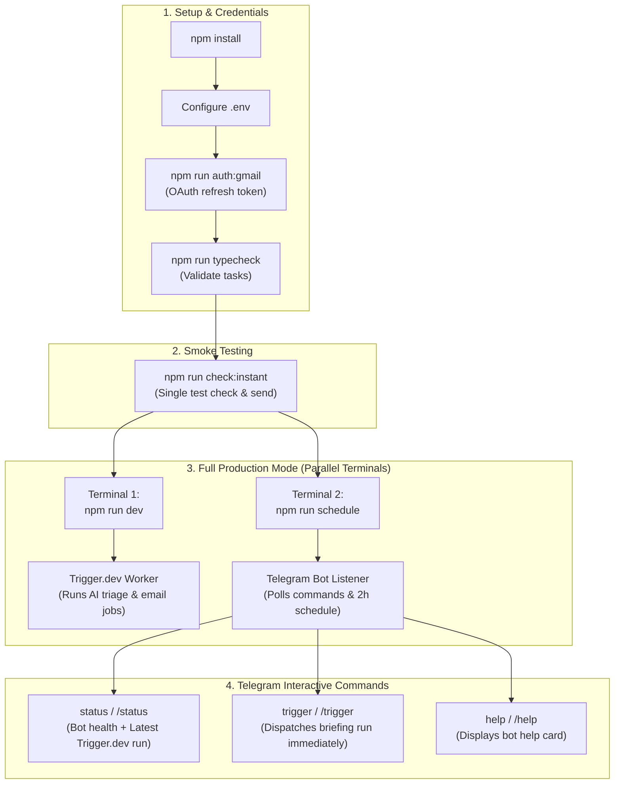

# 📧 Email Analysis & Headline Briefing Automation

An automated email triage assistant that inspects your Gmail inbox, prioritizes critical messages using **Ollama AI**, and sends structured executive briefings to your **Telegram** bot.

---

## 🚀 Features

- ⏱️ **Automatic 2-Hour Schedule**: Continuously monitors incoming emails and sends scheduled briefings.
- 💬 **On-Demand Telegram Control**: Text `trigger` to your bot at any time for an instant briefing.
- 🧠 **AI-Powered Inbox Triage**: Categorizes emails into high-priority items (work, university, billing/subscriptions) vs. low-priority promotional content.
- ⚡ **Action Item Extraction**: Highlights specific tasks and deadlines requiring your attention.
- 🔒 **Private & Secure**: Only responds to your authorized Telegram Chat ID; credentials remain stored locally in `.env`.

---

## 📋 Prerequisites

Before running the project, make sure you have:

1. **Node.js** (v18 or higher) — [Download Node.js](https://nodejs.org/)
2. **Ollama** running locally — [Download Ollama](https://ollama.com/)
   - Pull a model (e.g. `ollama pull gemma4:31b-cloud` or `ollama pull llama3.2:1b`)
3. **Google Cloud OAuth2 Credentials**:
   - Client ID, Client Secret, and Refresh Token with Gmail read permissions.
4. **Telegram Bot**:
   - Bot token from [@BotFather](https://t.me/BotFather)
   - Your user chat ID from [@userinfobot](https://t.me/userinfobot)

---

## 🛠️ Installation & Setup

### 1. Clone & Install Dependencies

```bash
git clone <your-repo-url>
cd "Email Analysis"
npm install
```

### 2. Configure Environment Variables

Copy `.env.example` to `.env`:

```bash
cp .env.example .env
```

Edit `.env` and fill in your keys:

```env
# Google Cloud OAuth (for Gmail access)
GMAIL_CLIENT_ID=your_google_client_id.apps.googleusercontent.com
GMAIL_CLIENT_SECRET=your_google_client_secret
GMAIL_REFRESH_TOKEN=your_google_refresh_token

# Ollama AI Configuration
OLLAMA_BASE_URL=http://127.0.0.1:11434
OLLAMA_MODEL=gemma4:31b-cloud
# OLLAMA_API_KEY=your_key_here (optional, only if using an authenticated Ollama endpoint)

# Telegram Bot Configuration
TELEGRAM_BOT_TOKEN=123456789:ABCdefGhIJKlmNoPQRstuVWXyz
TELEGRAM_CHAT_ID=1234567890
```

> **Note**: To obtain a Gmail refresh token using your Client ID and Client Secret, run:
> ```bash
> npm run auth:gmail
> ```

---

## 🗺️ Operational Command Flowchart

The system operates on a **dual-component architecture**: Trigger.dev serves as the task execution worker, while the Telegram listener acts as the command receiver and notification scheduler.



---

## 📋 Master Command Reference

| Step | Command | Purpose | Expected Output |
|---|---|---|---|
| **1. Install** | `npm install` | Install all required dependencies | Packages installed in `node_modules` |
| **2. Auth** | `npm run auth:gmail` | Authenticate Gmail OAuth and obtain refresh token | Prints `GMAIL_REFRESH_TOKEN` |
| **3. Validate** | `npm run typecheck` | Run TypeScript compiler to ensure task definitions are sound | Exits `0` with no compile errors |
| **4. Smoke Test** | `npm run check:instant` | One-off email fetch, Ollama triage & Telegram message | Instant briefing delivered |
| **5. Task Worker** | `npm run dev` | Starts local Trigger.dev worker (`trigger dev`) | `Local worker ready on branch: default` |
| **6. Bot & Schedule** | `npm run schedule` | Starts Telegram long-polling & 2-hour recurring scheduler | `🤖 Telegram Bot & Integrator Started` |

---

## 🏃 How to Run

### Complete Dual-Process Setup (Recommended for Full Automation)

To enable **both** background task processing via Trigger.dev and interactive Telegram control (`status`, `trigger`), run both processes in parallel:

1. **Terminal 1 — Trigger.dev Background Worker**:
   ```bash
   npm run dev
   ```
   *Connects to Trigger.dev and executes email analysis tasks.*

2. **Terminal 2 — Telegram Bot & Continuous Scheduler**:
   ```bash
   npm run schedule
   ```
   *(Aliases: `npm run bot` or `npm start`)*
   *Listens for incoming Telegram commands and triggers automatic briefings every 2 hours.*

---

### Individual Operational Modes

#### Mode 1: Telegram Bot & Local Scheduler
```bash
npm run schedule
```
- Listens for `/trigger`, `/status`, and `/help` in Telegram.
- Dispatches tasks to Trigger.dev (if `TRIGGER_SECRET_KEY` is configured) or runs locally.
- Automatically triggers a briefing every 2 hours.

#### Mode 2: Instant One-Off Email Check
```bash
npm run check:instant
```
- Fetches the last 2 hours of emails from Gmail.
- Summarizes and triages them with Ollama.
- Prints the briefing to the terminal and sends it to Telegram immediately.

#### Mode 3: Trigger.dev Background Worker Only
```bash
npm run dev
```
- Runs `trigger dev` to register and listen for runs of:
  - `email-briefing-scheduled` (Cron: every 2 hours)
  - `email-briefing-manual` (On-demand trigger)

---

## 💬 Telegram Bot Commands

Once `npm run schedule` is running, send any of the following messages to your bot in Telegram:

| Command | Action |
|---|---|
| `trigger` or `/trigger` | Immediately fetches the last 2 hours of emails and sends an instant briefing |
| `status` or `/status` | Checks bot health, last run time, and countdown to next scheduled briefing |
| `help` or `/help` | Displays available commands and configuration details |

---

## 📁 Project Structure

```
.
├── scripts/
│   ├── instant-check.mjs       # Core engine: Gmail fetch, Ollama prompt, Telegram sender
│   ├── telegram-listener.mjs   # 2-hour auto-scheduler + Telegram bot listener
│   └── get-gmail-token.mjs     # OAuth2 helper to generate a Gmail refresh token
├── src/
│   └── trigger/
│       └── email-briefing/
│           └── email-briefing.ts # Trigger.dev v3/v4 scheduled task definition
├── SUMMARY.md                  # Detailed architectural and workflow summary
├── package.json                # Project dependencies and run scripts
├── trigger.config.ts           # Trigger.dev project configuration
└── .env                        # Local credentials (never committed to git)
```

---

## 🔧 Troubleshooting

- **Ollama Connection Refused**:
  Ensure the Ollama application is running (`http://127.0.0.1:11434`). You can verify by visiting `http://127.0.0.1:11434` in your browser.
- **Gmail 401 Unauthorized / Token Expired**:
  Ensure `GMAIL_CLIENT_ID`, `GMAIL_CLIENT_SECRET`, and `GMAIL_REFRESH_TOKEN` are valid. If needed, re-run `npm run auth:gmail` to generate a fresh refresh token.
- **Telegram Access Denied**:
  Verify that `TELEGRAM_CHAT_ID` in `.env` exactly matches your Telegram account ID (obtained from [@userinfobot](https://t.me/userinfobot)).
