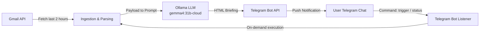

# Project Architecture & Workflow Summary: Email Analysis Automation

## Overview

The **Email Analysis Automation** is an intelligent inbox triage assistant. It periodically inspects incoming emails from Gmail, summarizes and prioritizes them using an LLM via **Ollama**, and delivers concise, actionable headline briefings directly to a private **Telegram** chat.

---

## Core Components

### 1. Ingestion & Authentication ([`scripts/instant-check.mjs`](file:///d:/Assets/Automation%20using%20claude%20code/Email%20Analysis/scripts/instant-check.mjs))
- **OAuth2 Token Refresh**: Uses Google Cloud OAuth client credentials (`GMAIL_CLIENT_ID`, `GMAIL_CLIENT_SECRET`, `GMAIL_REFRESH_TOKEN`) to exchange for short-lived access tokens via `https://oauth2.googleapis.com/token`.
- **Querying**: Fetches emails received within a defined lookback window (default: last 2 hours) using the Gmail query `q=after:{epoch_seconds}`.
- **MIME Parsing**: Handles nested multipart MIME bodies (both `text/plain` and `text/html`) with Base64URL decoding, extracting message snippets up to 1,500 characters per email.

### 2. AI Triage & Synthesis (Ollama)
- Communicates with Ollama over HTTP (`OLLAMA_BASE_URL`, default: `http://127.0.0.1:11434/api/chat`).
- Uses model `gemma4:31b-cloud` (or any local/cloud Ollama model specified in `.env`).
- Prompts the LLM with executive triage guidelines:
  - **High Priority**: Identifies School (university announcements, courses, deadlines), Work (clients, project updates), and Billing/Subscription expirations. Generates a 1-line headline bullet and explicit action item.
  - **Low Priority**: Aggregates promotional emails, newsletters, and social notifications (LinkedIn, marketing) into a single grouped line.
  - **Output Formatting**: Produces clean Telegram HTML formatting (`<b>`, `<i>`, `•`).
  - **Fallback Handling**: If Ollama is offline or unreachable, the system automatically falls back to a clean structured headline digest so messages are never dropped.

### 3. Telegram Delivery & Interactive Listener ([`scripts/telegram-listener.mjs`](file:///d:/Assets/Automation%20using%20claude%20code/Email%20Analysis/scripts/telegram-listener.mjs))
- **Direct Pushes**: Dispatches briefings to your private chat ID via `https://api.telegram.org/bot{token}/sendMessage` in HTML parse mode.
- **Long Polling (`getUpdates`)**: Listens continuously for user messages.
- **Security Check**: Enforces authorization strictly against `TELEGRAM_CHAT_ID`, instantly rejecting unauthorized users.
- **Interactive Commands**:
  - `trigger` / `/trigger`: Runs an on-demand briefing right away.
  - `status` / `/status`: Reports bot uptime, last run time, and countdown to the next scheduled run.
  - `help` / `/help`: Displays available commands.

### 4. Scheduling Options

The system supports two complementary execution architectures:
1. **Local Daemon Scheduler (`npm run schedule` / `npm run bot`)**:
   - Runs a continuous `setInterval` every 2 hours alongside the Telegram listener.
   - Ideal when using local Ollama on your machine without requiring cloud accounts.
2. **Trigger.dev Task Orchestrator ([`src/trigger/email-briefing/email-briefing.ts`](file:///d:/Assets/Automation%20using%20claude%20code/Email%20Analysis/src/trigger/email-briefing/email-briefing.ts))**:
   - Uses `@trigger.dev/sdk` with a cron schedule (`0 */2 * * *`) and a manual trigger task.
   - Can be run locally via `npm run dev` (`trigger dev`).

---

## Data Flow Details

1. **Trigger Event**: Either the 2-hour recurring timer fires, or the user sends `trigger` on Telegram.
2. **Concurrency Check**: If a briefing is already generating, concurrent requests are gracefully deferred with a warning.
3. **Gmail Fetch**: The system queries Gmail messages from the last 120 minutes. If no messages exist, it sends an inbox-clean notification.
4. **LLM Analysis**: The email metadata and bodies are formatted into an executive prompt and sent to Ollama.
5. **Dispatch**: The synthesized HTML briefing is sent to the authorized Telegram chat.
6. **Next Run Calculation**: The scheduler resets its countdown for the next 2-hour interval.
